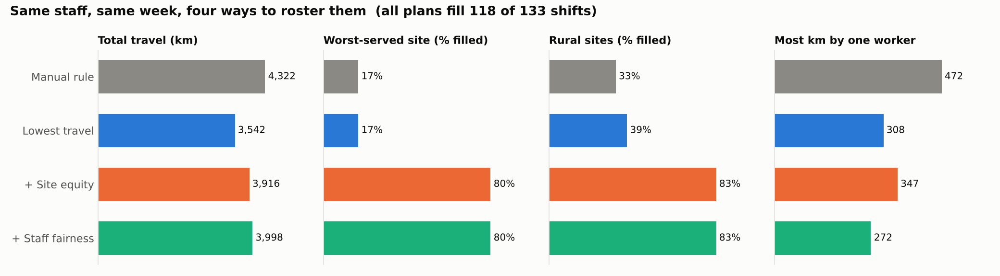
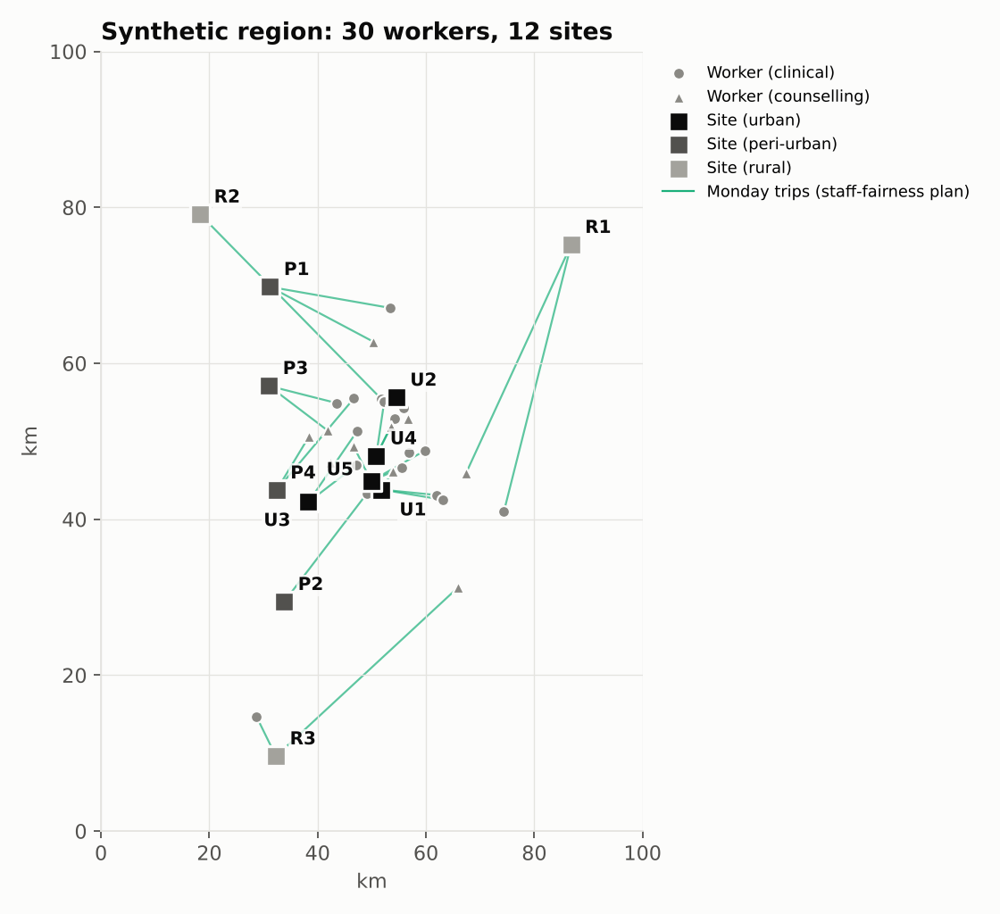
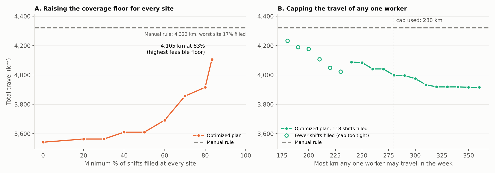

# Fair Staff Assignment for Community Health Outreach

Each week, someone running a community health program has to decide which clinical staff and counsellors go to which service sites. This project asks whether an integer programming model can make that decision better than a common manual rule, and what it costs to make the roster fairer to remote communities and to staff.

On the main test region, the model cuts total travel by 18.1%. With a coverage floor added, it lifts the worst-served site from 17% to 80% of its shifts while still using 9.4% less travel than the manual rule. The same pattern holds across 30 other randomly generated regions.

All data is synthetic. No real staff, sites or organizations are used.



## The setting

Most outreach staff live near the city, while some sites are rural and far away. There are also fewer staff-days than shifts, so some shifts will go unfilled whatever the roster. The real choice is which shifts go unfilled and who does the long drives.

The main test region (random seed 42) has:

- **30 workers:** 18 clinical and 12 counselling. Each has a home location and one weekday off, which leaves four working days.
- **12 sites:** 5 urban, 4 peri-urban and 3 rural. Rural sites run outreach on Monday, Wednesday and Friday only.
- **133 shifts** in a five-day week, against 120 staff-days. Because days off and skills do not line up exactly with demand, at most 118 shifts can be filled. A separate check in the tests confirms this.



## Four ways to build the roster

| Plan | How it works |
|---|---|
| Manual rule | Each day, fill urban sites first, then peri-urban, then rural. For each shift, send the nearest free worker with the right skill. |
| Lowest travel | Optimization model: fill as many shifts as possible, then minimize total round-trip km. |
| + Site equity | As above, but every site must get at least 80% of its weekly shifts. |
| + Staff fairness | Site equity, plus no worker may travel more than 280 km in the week. |

## The model

The decision variable `x[w, s, d]` equals 1 if worker *w* works at site *s* on day *d*. Every plan must respect the same rules: one site per worker per day, no work on a day off, at most four shifts a week, skills must match, and no site gets more staff than it asked for. The site floor and the travel cap are optional constraints.

The model is solved in two steps. Step 1 finds the largest number of shifts that any valid roster can fill. Step 2 keeps that number fixed and finds the roster with the least travel. This avoids choosing a penalty weight for unfilled shifts. A weight large enough to guarantee maximum fill also inflates the objective, and the solver's default optimality tolerance then becomes tens of km of travel.

There are about 1,300 binary variables. Each plan solves in under a second with the open-source HiGHS solver.

## Results on the main region

| Plan | Total km | vs manual | Worst-served site | Rural sites filled | Most km, one worker |
|---|---:|---:|---:|---:|---:|
| Manual rule | 4,322 | | 17% | 33% | 472 |
| Lowest travel | 3,542 | -18.1% | 17% | 39% | 308 |
| + Site equity | 3,916 | -9.4% | 80% | 83% | 347 |
| + Staff fairness | 3,998 | -7.5% | 80% | 83% | 272 |

All four plans fill the same 118 shifts. They differ in where the 15 gaps fall and who carries the travel.

The manual rule fills urban sites first and uses up the staff who live nearby. The rural shifts that remain go to whoever is still free, sometimes from far away, or stay empty. Two rural sites get only 1 of their 6 shifts.

Minimizing travel alone saves 18.1%, but it does not fix coverage. One rural site still gets 1 of 6 shifts, because rural shifts are the most expensive to fill.

Requiring every site to reach 80% adds 374 km to the cheapest plan (+10.6%). That is still 406 km less than the manual rule. Capping each worker at 280 km then cuts the heaviest weekly load from 472 km under the manual rule to 272 km (-42%), for another 82 km in total.

## Does it hold beyond one region?

One region could be a lucky draw, so the comparison was repeated on 30 other randomly generated regions (seeds 1 to 30) with the same rules.

- In every region, the model filled exactly as many shifts as the manual rule (between 113 and 119, depending on the region).
- The lowest-travel plan used a median 24.9% less travel than the manual rule (range 18.5% to 37.7%). The main region, at 18.1%, is at the low end.
- The manual rule left at least one site with no staff at all in 16 of the 30 regions. The lowest-travel plan did so in 6.
- The 80% site floor was feasible in all 30 regions. The equity plan still used a median 18.5% less travel than the manual rule (range 9.3% to 34.2%), and cost a median 7.3% more than the lowest-travel plan.

Full results are in `results/robustness.csv`.

## The cost of fairness



Panel A raises the coverage floor that every site must meet. Travel rises slowly up to a 60% floor (+150 km), then faster. The highest floor this staff can meet is 83.3%, which costs 4,105 km and is still 5.0% below the manual rule. Floors of 84% and above are infeasible. At that point a manager needs more staff, not a better roster.

Panel B caps the travel of any one worker while keeping the 80% floor. Caps of 240 km and above still fill all 118 shifts, and total travel falls from 4,087 km to 3,916 km as the cap is loosened. Below 240 km, one shift is lost (hollow points). The 280 km cap used in the main comparison is an illustrative middle point, not a recommendation.

## Limitations

- Distances are straight-line distance multiplied by 1.3, not real road routes or travel times.
- The model covers one week with fixed demand. It ignores absences, leave and changes in patient numbers.
- All workers with the same skill are treated as interchangeable. Real teams differ in experience, language and seniority.
- The weekly cap of four shifts equals each worker's available days here, so it never binds. It is kept in the model for settings where staff have more available days than shifts.
- The 80% floor and 280 km cap are chosen to illustrate the trade-offs.

Next steps would be to use real travel times, add uncertain demand and absences, and study whether managers and frontline staff accept and trust rosters produced by a model.

## Run it

```bash
pip install -r requirements.txt
python run_experiments.py   # about 45 seconds; writes results/*.csv and figures/*.png
python -m pytest -q         # 9 checks
```

Requires Python 3.10 or newer and PuLP 4.0 or newer.

## Files

```
src/data.py          synthetic workers, sites, demand and distances
src/baseline.py      the manual rostering rule
src/model.py         two-step integer programming model (PuLP + HiGHS)
src/evaluate.py      rule checker and scoring
run_experiments.py   main comparison, both sweeps, 30-region check and charts
results/             rosters and result tables (CSV)
figures/             charts used in this README
tests/               automated checks
```

Author: Ikike Nkanta. Licensed under MIT.
